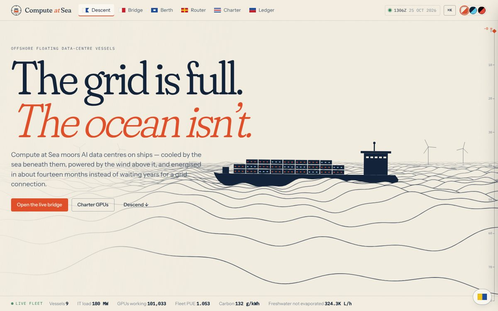
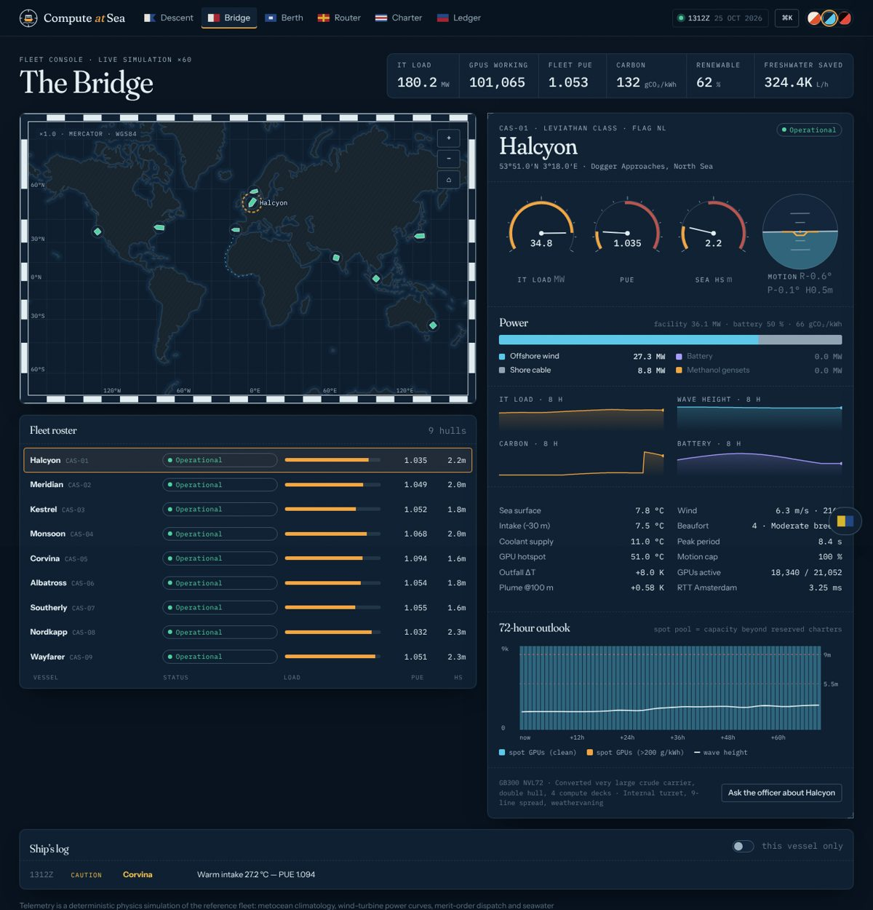
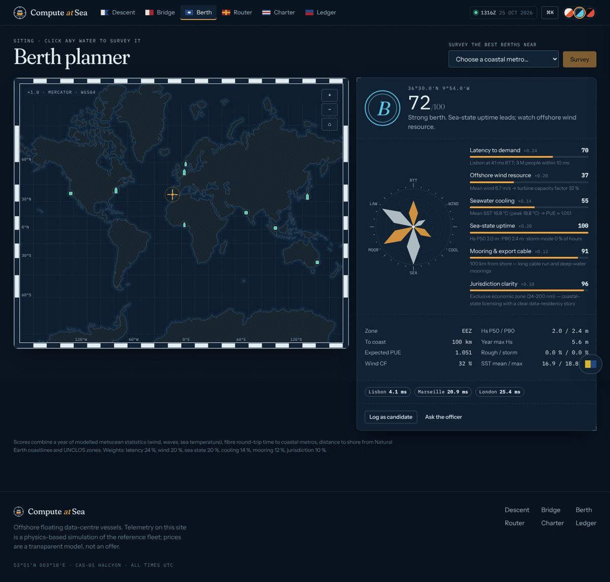
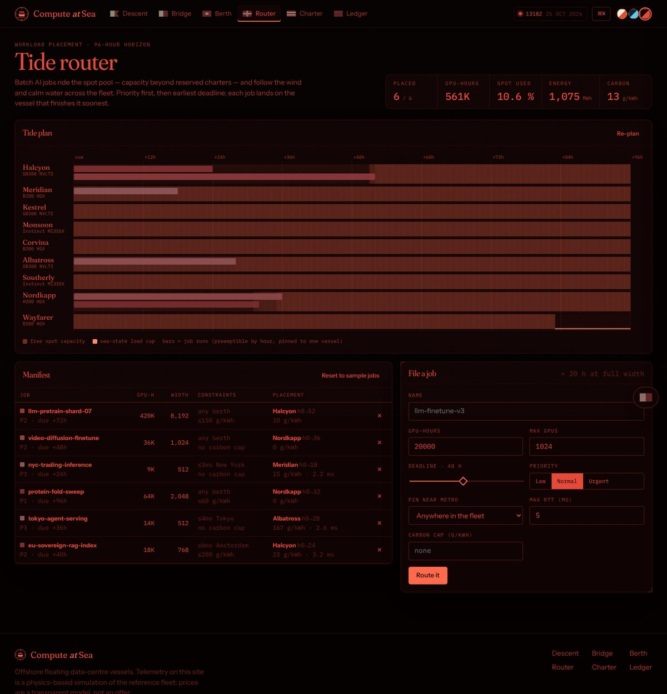
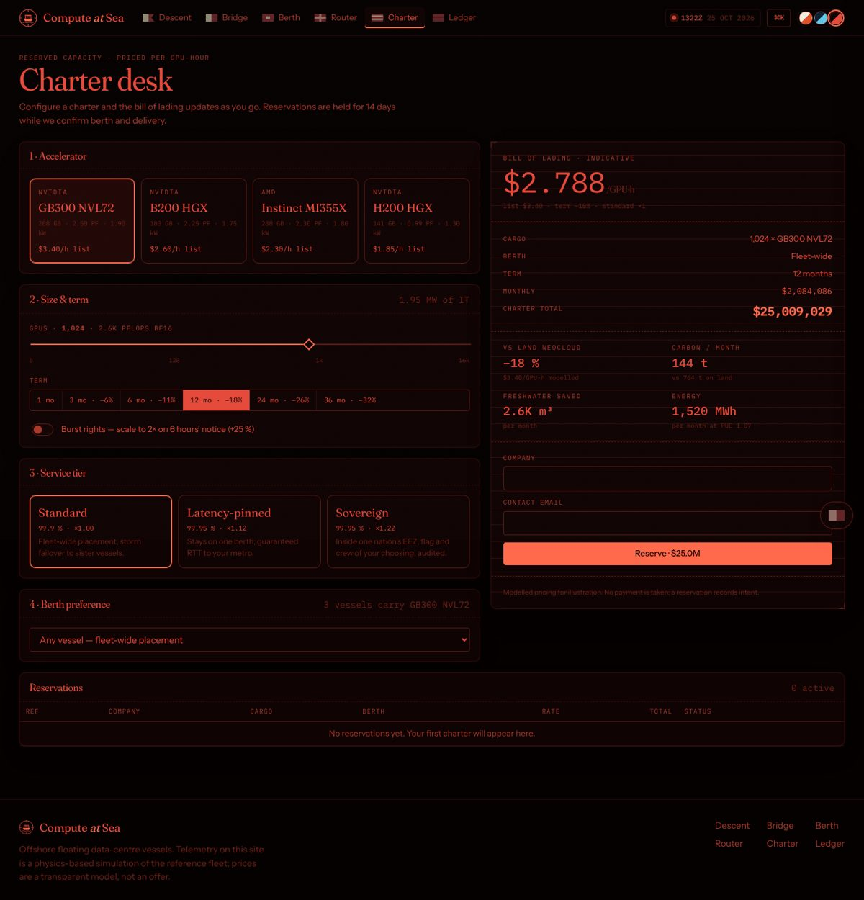

# Compute at Sea

**Offshore floating data-centre vessels for AI.** The grid is full. The ocean isn't.

Compute at Sea moors AI data centres on ships: cooled by seawater drawn from 30 m, powered by the offshore wind farm at the berth, and energised in about 14 months instead of waiting years in an interconnection queue.

This repository is the end-to-end product: a scroll-to-dive explainer, a live fleet console driven by a physics simulation, a berth-siting tool, a workload scheduler, a charter desk with persistence, a land-vs-sea economics lab, and a Claude-powered ops assistant.



| | |
|---|---|
|  |  |
| **Bridge**: live fleet console (Dusk palette) | **Berth planner**: score any patch of ocean |
|  |  |
| **Tide router**: ECDIS Night-red palette | **Charter desk**: the bill of lading |

## What's inside

| Section | Flag | What it does |
|---|---|---|
| **Descent** `/` | Alfa (*diver down*) | The pitch as a dive from 0 to −80 m. A canvas ocean with a converted tanker riding the swell, a live fleet ticker, an explorable 9-system vessel cutaway, the business model, risks with their mitigations, and a waitlist. |
| **Bridge** `/bridge` | Hotel (*pilot on board*) | Live SSE telemetry for 9 vessels on a nautical chart: dials, an artificial horizon for roll and pitch, the power mix, 8 h sparklines, a 72 h capacity and sea-state outlook, and the ship's log. |
| **Berth** `/berth` | Papa (*about to sail*) | Click any water to get a graded six-factor score (latency, wind, cooling, sea state, mooring, jurisdiction) drawn as a compass rose. You can also survey the best berths around any coastal metro. |
| **Router** `/router` | Romeo | The Tide Router places batch jobs on the fleet's spot pool under GPU-width, latency, carbon-cap and deadline constraints, and shows the result as a Gantt "tide plan". |
| **Charter** `/charter` | Charlie (*affirmative*) | Configure accelerator, size, term, tier and berth for an instant quote, then reserve. Reservations are persisted and can be released. |
| **Ledger** `/ledger` | Echo | Land-vs-sea cumulative cash, NPV and payback, with every assumption on a slider. |
| **Bridge Officer** | Kilo (*I wish to communicate*) | An AI assistant that answers from live telemetry through tools. |

**Also included:**
- A ⌘K command palette.
- Three bridge lighting palettes: *Day* paper chart, *Dusk* bridge glass, and *Night* ECDIS red.
- Full keyboard support and reduced-motion handling.
- A responsive layout down to phone width.

Read the brief in **[docs/PITCH.md](docs/PITCH.md)** and the system design in **[docs/ARCHITECTURE.md](docs/ARCHITECTURE.md)**.

## Quick start

Requires **Node 22.13+**, which provides the built-in `node:sqlite`.

```bash
npm install
npm run dev          # API on :8787, web on http://localhost:5173
```

For a production build:

```bash
npm run build
npm start            # serves API + built UI on http://localhost:8787
```

With Docker:

```bash
docker build -t compute-at-sea .
docker run -p 8787:8787 -v cas-data:/data compute-at-sea
```

### Configuration (`.env.example`)

| Variable | Default | Meaning |
|---|---|---|
| `PORT` | `8787` | HTTP port |
| `DATA_DIR` | `./data` | Where the SQLite database lives |
| `SIM_SPEED` | `60` | Simulated seconds per real second |
| `ANTHROPIC_API_KEY` | — | Turns on the Claude-powered Bridge Officer. Without it, a deterministic rules engine answers. |
| `BRIDGE_MODEL` | `claude-opus-5-5` | Claude model for the Bridge Officer |

## Quality

```bash
npm run lint        # ESLint (typescript-eslint, react-hooks)
npm run typecheck   # client + server
npm test            # 52 Vitest tests: physics, geo, berth, economics, scheduler, full HTTP API
```

CI runs all of these plus the build on every push (`.github/workflows/ci.yml`).

## Stack

- **Frontend:** React 19, Vite 6 and React Router 7. Charts are hand-built in SVG and Canvas with no chart library. The map uses d3-geo with Natural Earth land.
- **Backend:** Express 5 on Node 22, with zod validation, Server-Sent Events and `node:sqlite`.
- **AI:** the Anthropic TypeScript SDK tool runner with five read-only fleet tools.
- **Shared core:** the deterministic metocean, vessel, berth, economics and scheduling models, run identically on the server and in the browser.

## Honesty note

Fleet telemetry is a **simulation**. It is a deterministic model built from published physics and climatology (wind belts, Pierson–Moskowitz waves, turbine power curves, merit-order dispatch, seawater heat balance), not data from real vessels. Prices and the capital model are transparent, editable assumptions, not an offer. Industry figures on the landing page are indicative ranges.

## License

MIT
